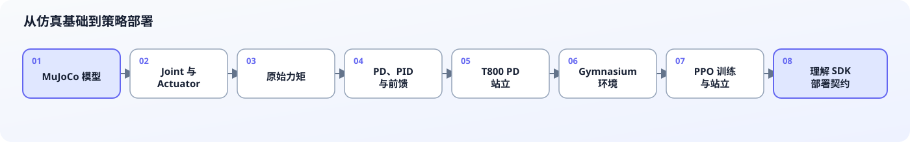

# T800：从 MuJoCo 关节控制到强化学习

这是一个面向初学者的中文教程。课程以 T800 的 MuJoCo 模型为对象，按章节学习：

1. MuJoCo 模型、关节、执行器和传感器；
2. 原始力矩控制；
3. P、PD、PID 与前馈控制；
4. T800 全身 PD 站立；
5. Gymnasium 强化学习环境；
6. PPO 单关节训练；
7. PPO 抗扰动站立；
8. 教学代码与 EngineAI 原生 SDK 的对应关系。

> [!WARNING]
> 本教程第一阶段仅用于 **MuJoCo 仿真**。不要把教程参数或策略直接用于实体机器人。实体机器人还需要急停、吊架、功率限制、通信失效保护和完整的人工安全审查。



阅读方式：前半段建立机器人与底层控制基础，后半段在同一套 PD 安全层之上学习强化学习，最后再映射回 SDK。

## 适合谁

你只需要：

- 能阅读基础 Python；
- 了解一点 PID（不了解也可以从第 03 章开始补齐）；
- 不要求预先掌握 MuJoCo、Gymnasium、PPO 或机器人动力学。

## 教程形式

教程严格按章节组织，每章是一个独立 Markdown 文件。**所有代码只放在对应章节的 Markdown 代码块中**，仓库不另外维护 `.py`、Notebook 或教学配置文件。

使用方法：

1. 按顺序阅读章节；
2. 将章节标注的完整代码块手动复制到建议的临时文件名；
3. 在仓库根目录运行命令；
4. 完成章末验收清单后再进入下一章。

这样可以先理解每一行代码，再决定如何组织自己的工程。

## 环境安装

本教程使用 Conda 环境 `t800` 和 Python 3.12。以下命令从仓库根目录执行：

```bash
cd /path/to/mujoco_t800_rl
conda create -n t800 python=3.12
conda activate t800
python -m pip install --upgrade pip
python -m pip install mujoco numpy gymnasium stable-baselines3 torch
```

检查 Python、pip 和基础依赖版本：

```bash
python --version
python -m pip --version
python -c "import mujoco, numpy, gymnasium, stable_baselines3, torch; print('MuJoCo:', mujoco.__version__); print('NumPy:', numpy.__version__); print('Gymnasium:', gymnasium.__version__); print('SB3:', stable_baselines3.__version__); print('PyTorch:', torch.__version__)"
```

`python --version` 应显示 Python 3.12，`python -m pip --version` 的路径应位于 `t800` 环境中。MuJoCo 官方 Python wheel 自带 MuJoCo 运行库，一般不需要另行下载旧版 `mujoco-py`。

TensorBoard 和 PyYAML 不属于基础依赖；仅在对应章节需要相关功能时按说明安装。

## 章节目录

| 章节 | 内容 | 完成后的能力 |
|---|---|---|
| [第 00 章：安装与仿真安全](tutorials/00_安装与仿真安全.md) | 环境、加载模型、headless 与 viewer | 能加载并步进 T800 模型 |
| [第 01 章：T800 模型与关节](tutorials/01_T800模型与关节.md) | body、joint、actuator、sensor、自由基座 | 能按名称读取 25 个关节和传感器 |
| [第 02 章：执行器与力矩控制](tutorials/02_执行器与力矩控制.md) | `data.ctrl`、单关节、波形力矩 | 能安全施加并观察原始力矩 |
| [第 03 章：PD、PID 与前馈控制](tutorials/03_PD_PID与前馈控制.md) | P/PD/PID、限幅、anti-windup | 能实现和调试关节闭环控制 |
| [第 04 章：T800 PD 站立](tutorials/04_T800_PD站立.md) | 25 关节映射、五次轨迹、全身 PD | 能在仿真中执行平滑站立控制 |
| [第 05 章：强化学习与 Gymnasium](tutorials/05_强化学习与Gymnasium.md) | observation、action、reward、episode | 能实现并检查单关节 RL 环境 |
| [第 06 章：PPO 单关节训练](tutorials/06_PPO单关节训练.md) | PPO 训练、保存、加载、评估 | 能完成第一个策略训练闭环 |
| [第 07 章：T800 抗扰动站立](tutorials/07_T800抗扰动站立训练.md) | 分层 PD、站立奖励、PPO | 能训练并评估站立策略 |
| [第 08 章：与原生 SDK 对应](tutorials/08_与原生SDK的对应关系.md) | joint order、观测、动作、部署边界 | 能读懂 SDK 的控制与策略部署流程 |

请不要跳过第 00～04 章直接训练 T800。强化学习环境中的动作最终仍需通过底层关节控制作用于机器人；如果不理解 joint、actuator、`qpos/qvel` 和力矩限幅，很难判断训练失败的真正原因。

## 仓库中的模型与参考实现

本教程直接使用：

- T800 模型入口：[models/t800/t800.xml](models/t800/t800.xml)
- T800 机器人 MJCF：[models/t800/robot/t800/xml/](models/t800/robot/t800/xml/)

[engineai_robotics_native_sdk/](engineai_robotics_native_sdk/) 是参考资料，不是前几章的运行依赖。教程主要对照：

- 关节与 limb 顺序：`assets/config/t800/model/default.yaml`
- 执行器及力矩范围：`assets/resource/robot/t800/xml/serial_actuators.xml`
- PD 站立目标和增益：`assets/config/t800/pd_stand/default.yaml`
- MuJoCo PD + 前馈公式：`simulation/mujoco/main.cc`
- 已训练策略的部署流程：`src/runner/rl_walking_example/`

SDK 的底层公式是：

```text
tau = kp * (q_des - q) + kd * (qd_des - qd) + tau_ff
```

它是 **PD + 前馈**，不是完整 PID。积分项会在第 03 章用于教学，但 T800 全身控制默认不使用积分项。

## Headless 与图形界面

- 模型检查、自动测试和训练应优先使用 headless 模式，不打开 viewer。
- viewer 用于理解模型和评估策略，不应在大规模训练时逐帧渲染。
- 远程 Linux 没有显示服务器时，viewer 可能无法启动；这不影响 headless 仿真。
- 训练运行得比实时快或慢都正常；MuJoCo 的物理时间由模型 timestep 决定，而不是墙钟时间。

## 第一阶段边界

本教程第一版止于“纯 MuJoCo 中用 PPO 学习抗扰动站立”。暂不包含：

- 速度指令行走；
- 将策略直接转换成 SDK 的 MNN walking policy；
- LCM/C++ SDK 集成；
- 实体机器人部署。

完成第 08 章后，再逐步研究 22 关节 walking action、观测历史、domain randomization、模型导出与 sim-to-real，会更稳妥。

从 [第 00 章](tutorials/00_安装与仿真安全.md) 开始。