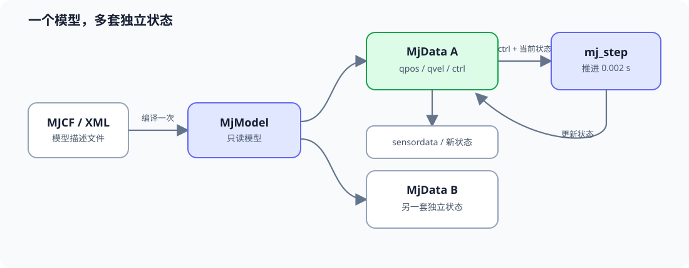
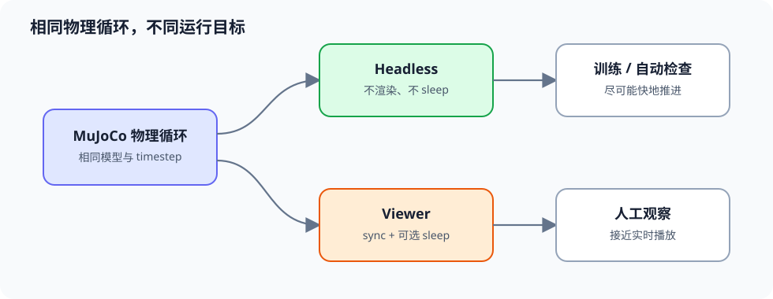

# 第 00 章：安装、模型加载与仿真安全

> 上一章：无 ｜ [课程首页](../README.md) ｜ [下一章：T800 模型与关节](01_T800模型与关节.md)

## 0.1 本章目标

学完本章后，你将能够：

1. 在 Conda 环境 `t800` 中使用 Python 3.12 安装官方 MuJoCo Python 包；
2. 加载仓库内的 T800 MJCF 模型；
3. 区分 `MjModel`、`MjData` 和 `mj_step`；
4. 理解 `nq`、`nv`、`nu`、`nsensor` 与仿真步长；
5. 分别运行无窗口仿真和可视化仿真。

## 0.2 前置知识与安全边界

你只需会使用终端和基础 Python。本课程当前阶段**只操作 MuJoCo 仿真**：

- 不连接机器人；
- 不发送 LCM、ROS 2 或电机命令；
- 不运行 SDK 的真机脚本；
- 后续出现的力矩上限也只是仿真教学限制，不能直接作为真机参数。

`engineai_robotics_native_sdk/` 是控制语义、关节顺序和部署结构的参考，不是本课程前几章的运行依赖。

## 0.3 创建 Conda 环境

本教程使用 Conda 环境 `t800` 和 Python 3.12。以下命令均从仓库根目录执行：

```bash
cd /path/to/mujoco_t800_rl
conda create -n t800 python=3.12
conda activate t800
python -m pip install --upgrade pip
python -m pip install mujoco numpy gymnasium stable-baselines3 torch
```

检查 Python、pip 和基础依赖版本：

```bash
python --version
python -m pip --version
python -c "import mujoco, numpy, gymnasium, stable_baselines3, torch; print('MuJoCo:', mujoco.__version__); print('NumPy:', numpy.__version__); print('Gymnasium:', gymnasium.__version__); print('SB3:', stable_baselines3.__version__); print('PyTorch:', torch.__version__)"
```

`python --version` 应显示 Python 3.12，`python -m pip --version` 的路径应位于 `t800` 环境中。

> 以后重新打开终端，只需进入仓库并执行 `conda activate t800`。

## 0.4 MuJoCo 中最重要的三个对象

- `mujoco.MjModel`：由 XML 编译出的**只读模型描述**，包含质量、关节、执行器、时间步长等。
- `mujoco.MjData`：一次仿真实例的**可变状态**，包含位置 `qpos`、速度 `qvel`、控制输入 `ctrl`、传感器数据等。
- `mujoco.mj_step(model, data)`：根据当前状态和控制输入，将物理仿真向前推进一个 timestep。

模型和状态分开很有用：一个 `MjModel` 可以创建多个 `MjData`，用于并行训练多个环境。



读图方法：`MjModel` 描述“机器人是什么”，每个 `MjData` 保存“机器人此刻怎样”，`mj_step` 则用控制输入把其中一套状态向前推进。

## 0.5 完整程序：加载模型并进行无窗口仿真

将下面的完整代码手动复制为临时文件，例如 `/tmp/lesson00_load_t800.py`。仓库中不保存该 `.py` 文件。

```python
from pathlib import Path

import mujoco
import numpy as np


# 本程序要求从仓库根目录运行。
MODEL_PATH = Path("models/t800/t800.xml").resolve()


def main() -> None:
    if not MODEL_PATH.is_file():
        raise FileNotFoundError(
            f"找不到模型：{MODEL_PATH}\n"
            "请确认当前目录是 mujoco_t800_rl 仓库根目录。"
        )

    model = mujoco.MjModel.from_xml_path(str(MODEL_PATH))
    data = mujoco.MjData(model)

    print(f"MuJoCo version : {mujoco.__version__}")
    print(f"model path     : {MODEL_PATH}")
    print(f"nq             : {model.nq}")
    print(f"nv             : {model.nv}")
    print(f"nu             : {model.nu}")
    print(f"nsensor        : {model.nsensor}")
    print(f"timestep       : {model.opt.timestep:.6f} s")
    print(f"qpos shape     : {data.qpos.shape}")
    print(f"qvel shape     : {data.qvel.shape}")
    print(f"ctrl shape     : {data.ctrl.shape}")

    # XML 中 LINK_BASE 的初始位置和单位四元数已写入 qpos0。
    # mj_resetData 会恢复到该默认状态。
    mujoco.mj_resetData(model, data)
    mujoco.mj_forward(model, data)

    simulated_seconds = 1.0
    steps = round(simulated_seconds / model.opt.timestep)

    # 暂时不施加任何执行器控制。自由基座机器人会受重力影响并跌倒；
    # 这是正确的物理结果，不是 MuJoCo 出错。
    data.ctrl[:] = 0.0
    for _ in range(steps):
        mujoco.mj_step(model, data)
        if not (np.all(np.isfinite(data.qpos)) and np.all(np.isfinite(data.qvel))):
            raise FloatingPointError("仿真状态出现 NaN 或 Inf")

    print(f"simulated time : {data.time:.3f} s")
    print(f"base xyz       : {data.qpos[:3]}")
    print("headless simulation finished")


if __name__ == "__main__":
    main()
```

运行：

```bash
python /tmp/lesson00_load_t800.py
```

### 预期现象

你应看到：

- `nu` 为 `25`，对应 25 个执行器；
- timestep 为 `0.002000 s`，即物理频率 500 Hz；
- `nq` 与 `nv` 不相等；
- 运行 1 秒对应约 500 次 `mj_step`；
- 零控制下机器人会跌倒，最终 base 高度低于初始高度。

## 0.6 为什么 `nq != nv`

T800 是自由基座机器人。它的基座位置在 `qpos` 中使用：

- 平移：3 维；
- 单位四元数：4 维；
- 合计：7 维。

但刚体速度在 `qvel` 中使用：

- 线速度：3 维；
- 角速度：3 维；
- 合计：6 维。

四元数有 4 个数，但受单位长度约束，实际旋转自由度仍是 3。因此自由基座使 `nq` 比 `nv` 多 1。后续访问关节状态时，我们会查询 MuJoCo 的地址表，而不是到处硬编码 `qpos[7:]` 和 `qvel[6:]`。

## 0.7 完整程序：可选 Viewer

Viewer 需要桌面显示环境。将以下代码复制为 `/tmp/lesson00_viewer.py`：

```python
from pathlib import Path
import time

import mujoco
import mujoco.viewer


MODEL_PATH = Path("models/t800/t800.xml").resolve()


def main() -> None:
    model = mujoco.MjModel.from_xml_path(str(MODEL_PATH))
    data = mujoco.MjData(model)
    mujoco.mj_resetData(model, data)
    mujoco.mj_forward(model, data)

    with mujoco.viewer.launch_passive(model, data) as viewer:
        while viewer.is_running() and data.time < 10.0:
            wall_start = time.time()
            data.ctrl[:] = 0.0
            mujoco.mj_step(model, data)
            viewer.sync()

            # 仅用于让 viewer 接近实时播放；训练时不要 sleep。
            remaining = model.opt.timestep - (time.time() - wall_start)
            if remaining > 0:
                time.sleep(remaining)


if __name__ == "__main__":
    main()
```

运行：

```bash
python /tmp/lesson00_viewer.py
```

机器人跌倒是本章预期结果。下一章先理解模型结构，之后才加入控制器。

## 0.8 物理时间、墙上时间与训练速度

- **物理时间**：`data.time`，每次 `mj_step` 增加 `model.opt.timestep`。
- **墙上时间**：现实世界经过的时间。
- **实时播放**：让两者大致相同，方便观察。
- **强化学习训练**：通常关闭 viewer 和 `sleep`，让物理时间尽可能快地推进。



读图方法：headless 与 viewer 使用同一套物理模型和 timestep，差别主要在是否渲染、是否等待墙钟时间。

所以“5 秒仿真”可能在真实世界中不到 1 秒完成，也可能因渲染而超过 5 秒。

## 0.9 常见错误

### `ModuleNotFoundError: No module named 'mujoco'`

确认 Conda 环境 `t800` 已激活，并检查当前解释器与 pip：

```bash
conda activate t800
python --version
python -m pip --version
python -c "import mujoco; print(mujoco.__version__)"
```

Python 应为 3.12，pip 路径应位于 `t800` 环境中。

### 找不到 `models/t800/t800.xml`

程序使用相对仓库根目录的路径。先执行：

```bash
cd /path/to/mujoco_t800_rl
```

### Viewer 无法打开

服务器、SSH 会话或容器可能没有显示服务。先运行无窗口程序；后续训练本来也应使用 headless 模式。

### 机器人一开始就倒下

零力矩的自由基座机器人无法主动抵抗重力。跌倒证明动力学正在工作，不代表模型损坏。

## 0.10 小练习

1. 将无窗口仿真时间从 1 秒改为 0.2 秒，并确认 step 数变为 100 左右。
2. 打印 `model.nbody`、`model.njnt` 和 `model.ngeom`。
3. 创建两个独立的 `MjData(model)`，确认推进其中一个不会改变另一个的 `time`。
4. 思考：为什么训练时不应该每个物理步都渲染？

## 0.11 验收清单

- [ ] 能打印 MuJoCo 版本。
- [ ] 能从仓库根目录加载 T800 XML。
- [ ] 确认 `model.nu == 25`。
- [ ] 确认 `model.opt.timestep == 0.002`。
- [ ] 能解释 `MjModel` 与 `MjData` 的区别。
- [ ] 能解释自由基座下 `nq != nv` 的原因。
- [ ] 无 Viewer 时仍能完成 headless 仿真。

## 0.12 与原生 SDK 的关系

SDK 仿真器同样加载 T800 XML，并在 2 ms 周期内更新物理状态。不同之处是 SDK 的 [simulation/mujoco/main.cc](../engineai_robotics_native_sdk/simulation/mujoco/main.cc) 还通过 LCM 收发命令和状态。本课程先直接使用官方 Python binding，以便清晰看到 `model`、`data` 和控制循环；掌握后再在第 08 章映射回 SDK。

> 下一步：[第 01 章：T800 模型与关节](01_T800模型与关节.md)
