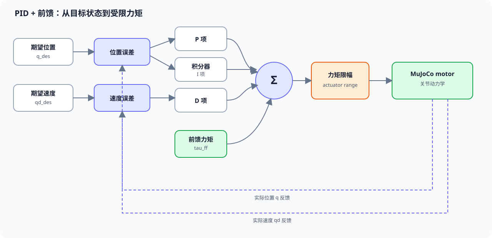
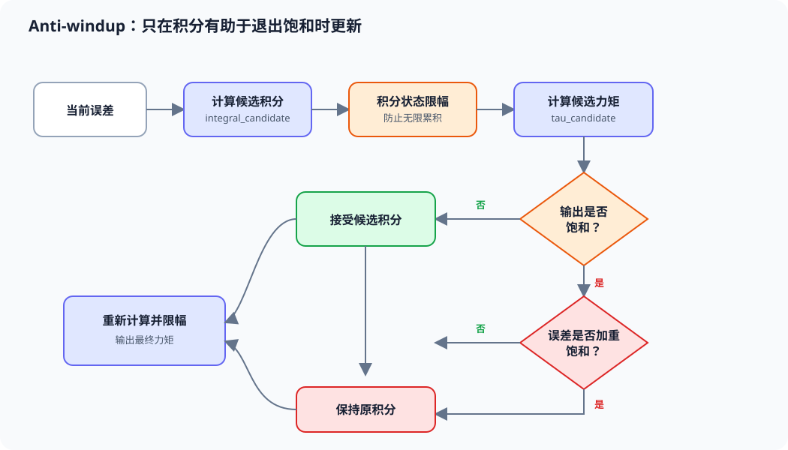

# 第 03 章：PD、PID 与前馈控制

> 本章目标：在上一章的单关节模型上，亲手比较 P、PD、PID 和前馈控制；理解为什么 T800 的关节层主要使用 **PD + 前馈**，而不是完整 PID。

[← 第 02 章：执行器与力矩控制](02_执行器与力矩控制.md) ｜ [课程首页](../README.md) ｜ [第 04 章：T800 PD 站立 →](04_T800_PD站立.md)

---

## 1. 从误差到力矩

设关节实际角度、速度为 `q`、`qd`，期望值为 `q_des`、`qd_des`：

```text
位置误差 e    = q_des  - q
速度误差 edot = qd_des - qd
```

SDK 与本教程的关节控制公式为：

```text
tau = kp * e + kd * edot + tau_ff
```

各项作用如下：

| 项 | 含义 | 直观效果 |
|---|---|---|
| `kp * e` | 比例项 P | 像弹簧一样拉向目标角 |
| `kd * edot` | 微分项 D | 像阻尼器一样抑制振荡 |
| `ki * integral(e)` | 积分项 I | 累积长期误差，消除恒定扰动造成的偏差 |
| `tau_ff` | 前馈力矩 | 直接补偿已知重力或负载，不必等误差出现 |

下面的框图展示四条力矩分量如何汇合，以及关节状态如何闭环反馈：



**读图方法：**P、I、D 都依赖反馈误差；前馈不等待误差出现，直接进入力矩求和。最终力矩必须先限幅，再写入 `data.ctrl`。当 `ki=0` 时，积分支路关闭，框图就退化为 SDK 使用的 PD + 前馈。

> MuJoCo 模型中的 actuator 是 torque motor，因此 `data.ctrl` 接收的是力矩，不是目标角。目标角必须先经过控制器计算成力矩。

---

## 2. 为什么积分项必须小心

如果输出已经达到 actuator 上限，但误差仍存在，积分器会继续累积。解除饱和后，过大的积分仍推动关节，这叫 **积分饱和（windup）**。

本章使用两层保护：

1. `integral` 本身限幅；
2. 若候选输出已饱和，而且当前误差会让饱和更严重，则暂停积分。



**读图方法：**积分限幅约束积分器本身；条件积分则观察执行器是否饱和。只有“已经饱和且继续积分会推得更远”时才冻结积分，误差正在帮助退出饱和时仍允许积分更新。

在人形机器人上，跌倒、触地冲击、关节限位和频繁变化的目标都容易导致 windup。因此实际 T800 控制默认 `ki = 0`，采用更可预测的 PD + 前馈。

---

## 3. 准备单关节模型

继续使用单关节教学思路。为保证本章参数一致，请将下列内容复制到临时文件 `/tmp/single_hinge_pid.xml`（不要写入仓库）：

```xml
<mujoco model="single_hinge">
  <compiler angle="radian" autolimits="true"/>
  <option timestep="0.002" gravity="0 0 -9.81" integrator="implicitfast"/>
  <worldbody>
    <body name="link" pos="0 0 1">
      <joint name="hinge" type="hinge" axis="0 1 0"
             range="-1.5708 1.5708" damping="0.05"/>
      <geom type="capsule" fromto="0 0 0 0 0 -0.6"
            size="0.04" mass="1" rgba="0.2 0.6 0.9 1"/>
    </body>
  </worldbody>
  <actuator>
    <motor name="hinge_motor" joint="hinge"
           ctrllimited="true" ctrlrange="-8 8"/>
  </actuator>
</mujoco>
```

水平转轴使重力力矩可见。控制范围为 `[-8, 8] N·m`，远小于 T800 的额定力矩，更适合学习。

---

## 4. 完整实验程序

将下面完整代码复制为临时文件 `/tmp/lesson03_pid.py`。程序依次运行 P、PD、PID 和 PD + 前馈，并打印末端误差、最大误差与饱和比例。

```python
from dataclasses import dataclass
from pathlib import Path
import math
import sys

import mujoco
import numpy as np


@dataclass
class PIDController:
    kp: float
    kd: float
    ki: float = 0.0
    integral_limit: float = 0.5
    torque_limit: float = 8.0
    integral: float = 0.0

    def reset(self) -> None:
        self.integral = 0.0

    def compute(
        self,
        q: float,
        qd: float,
        q_des: float,
        qd_des: float,
        dt: float,
        tau_ff: float = 0.0,
    ) -> float:
        if not np.isfinite([q, qd, q_des, qd_des, dt, tau_ff]).all():
            self.reset()
            return 0.0
        if dt <= 0.0:
            raise ValueError("dt 必须大于 0")

        error = q_des - q
        velocity_error = qd_des - qd

        # 先构造候选积分，再判断是否会加重输出饱和。
        candidate_integral = np.clip(
            self.integral + error * dt,
            -self.integral_limit,
            self.integral_limit,
        )
        candidate_tau = (
            self.kp * error
            + self.kd * velocity_error
            + self.ki * candidate_integral
            + tau_ff
        )

        saturated_high = candidate_tau > self.torque_limit
        saturated_low = candidate_tau < -self.torque_limit
        worsens_saturation = (
            (saturated_high and error > 0.0)
            or (saturated_low and error < 0.0)
        )
        if not worsens_saturation:
            self.integral = float(candidate_integral)

        tau = (
            self.kp * error
            + self.kd * velocity_error
            + self.ki * self.integral
            + tau_ff
        )
        return float(np.clip(tau, -self.torque_limit, self.torque_limit))


def load_model(xml_path: Path):
    model = mujoco.MjModel.from_xml_path(str(xml_path.resolve()))
    data = mujoco.MjData(model)
    joint_id = mujoco.mj_name2id(model, mujoco.mjtObj.mjOBJ_JOINT, "hinge")
    actuator_id = mujoco.mj_name2id(
        model, mujoco.mjtObj.mjOBJ_ACTUATOR, "hinge_motor"
    )
    if joint_id < 0 or actuator_id < 0:
        raise RuntimeError("模型中缺少 hinge 或 hinge_motor")
    qpos_adr = int(model.jnt_qposadr[joint_id])
    dof_adr = int(model.jnt_dofadr[joint_id])
    return model, data, qpos_adr, dof_adr, actuator_id


def run_case(name, controller, tau_ff=0.0, duration=4.0):
    model, data, qadr, dadr, actuator_id = load_model(Path("/tmp/single_hinge_pid.xml"))
    dt = float(model.opt.timestep)
    q_des = math.radians(35.0)
    controller.reset()

    errors = []
    torques = []
    for _ in range(round(duration / dt)):
        q = float(data.qpos[qadr])
        qd = float(data.qvel[dadr])
        tau = controller.compute(q, qd, q_des, 0.0, dt, tau_ff)
        data.ctrl[actuator_id] = tau
        mujoco.mj_step(model, data)

        if not np.isfinite(data.qpos).all() or not np.isfinite(data.qvel).all():
            raise FloatingPointError(f"{name}: 仿真出现 NaN/Inf")
        errors.append(q_des - q)
        torques.append(tau)

    errors = np.asarray(errors)
    torques = np.asarray(torques)
    saturated = np.mean(np.isclose(np.abs(torques), controller.torque_limit))
    print(
        f"{name:12s} | final_error={math.degrees(errors[-1]):7.3f} deg "
        f"| max_error={math.degrees(np.max(np.abs(errors))):7.3f} deg "
        f"| saturation={100*saturated:5.1f}% "
        f"| integral={controller.integral:7.4f}"
    )


def main():
    if not Path("/tmp/single_hinge_pid.xml").exists():
        sys.exit("请先创建 /tmp/single_hinge_pid.xml")

    # 同一目标、同一模型，仅改变控制器。
    run_case("P", PIDController(kp=8.0, kd=0.0))
    run_case("PD", PIDController(kp=8.0, kd=1.2))
    run_case("PID", PIDController(kp=8.0, kd=1.2, ki=2.0))

    # 约 3 N·m 的前馈只是教学估值：实际重力补偿应由动力学模型计算。
    run_case(
        "PD+feedforward",
        PIDController(kp=8.0, kd=1.2),
        tau_ff=3.0,
    )


if __name__ == "__main__":
    main()
```

运行：

```bash
python /tmp/lesson03_pid.py
```

数值会随 MuJoCo 版本和模型参数略有变化，但应观察到：

- P 控制通常有明显振荡或稳态误差；
- 增加 D 后，振荡减小；
- I 能继续消除长期误差，但调得过大容易超调；
- 合理前馈能在不累积历史误差的情况下减小偏差；
- 力矩始终不超过 `8 N·m`。

---

## 5. 调参顺序

建议按以下顺序，不要一次同时改三个参数：

1. 设置 `ki=0, kd=0`，逐渐增加 `kp`，直到响应足够快但开始振荡；
2. 增加 `kd`，直到振荡得到抑制；
3. 只有存在确定的长期偏差时，才从很小的 `ki` 开始；
4. 如果负载已知，优先考虑物理意义明确的 `tau_ff`；
5. 每次都检查饱和比例。长期饱和说明问题不一定能靠继续加增益解决。

经验上，D 项直接使用状态中的速度误差，比对位置误差做数值差分更少噪声。

---

## 6. 与 T800 SDK 的对应关系

SDK 的仿真回调在：

- `engineai_robotics_native_sdk/simulation/mujoco/main.cc`
- 函数 `TorqueController()`

核心公式是：

```cpp
tau_cmd = kp.cwiseProduct(q_cmd - q)
        + kd.cwiseProduct(qd_cmd - qd)
        + tau_ff;
```

它与本章 `compute()` 的符号完全一致，但没有积分项。SDK 的 `pd_stand_runner` 负责生成平滑的 `q_cmd`、`qd_cmd`；MuJoCo 回调负责将命令变成力矩。下一章将用 Python 重建这条完整链路。

---

## 7. 常见错误

### 7.1 把 `data.ctrl` 写成目标角

错误：

```python
data.ctrl[0] = q_des
```

这里的 `q_des` 会被解释为 N·m，而不是 rad。正确做法是先用控制公式得到 `tau`。

### 7.2 D 项符号写反

正确形式是 `kd * (qd_des - qd)`。当目标速度为 0 时，它等价于 `-kd * qd`，应阻碍当前运动。

### 7.3 忽略单位

- 角度：rad；
- 角速度：rad/s；
- 力矩：N·m；
- timestep：s。

### 7.4 只看最终误差

最终误差小不代表控制安全。还要看超调、速度、饱和比例和恢复时间。

---

## 8. 安全提示

- 本章参数只适用于教学单关节模型，不能直接用于 T800 或真机。
- 修改控制范围后，要同时修改软件中的 `torque_limit`，取两者更小值。
- 遇到 NaN/Inf 应立即输出零力矩并复位积分器。
- 真机还需要通信超时、急停、姿态保护、温度/电流保护等，本教程未覆盖。

---

## 9. 练习

1. 将 `kd` 依次改为 `0.2、0.8、2.0`，比较最大速度和最终误差。
2. 将 `integral_limit` 改为 `0.05` 和 `2.0`，观察恢复过程。
3. 故意把力矩上限降到 `1 N·m`，验证 anti-windup 是否阻止积分持续增大。
4. 将目标角改成随时间变化的正弦轨迹，设置对应的 `qd_des`。
5. 推导该单摆在目标角处的重力补偿，替代固定 `tau_ff=3.0`。

---

## 10. 本章验收清单

- [ ] 能解释 `P`、`D`、`I` 和 `tau_ff` 的不同作用。
- [ ] 知道 SDK 实际使用 PD + 前馈，而不是完整 PID。
- [ ] D 项方向能抑制当前运动。
- [ ] 输出力矩始终处于 actuator 范围内。
- [ ] 积分器有限幅，并在非有限状态时复位。
- [ ] 能解释为什么人形机器人全身控制通常把 `ki` 设为 0。

[← 第 02 章](02_执行器与力矩控制.md) ｜ [第 04 章：T800 PD 站立 →](04_T800_PD站立.md)
